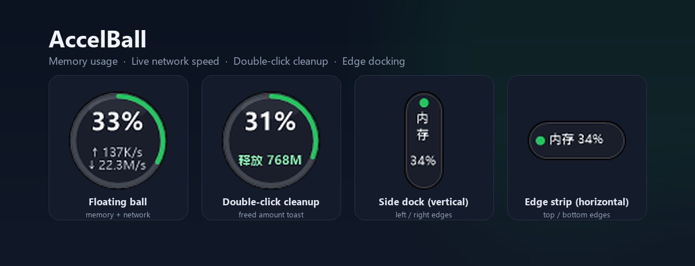

# AccelBall

English | [简体中文](README.zh-CN.md)

A Windows 10 desktop floating "acceleration ball" inspired by the ball widget found in
antivirus and PC-manager suites. It does four things:

1. An always-on-top circular ball showing the current physical memory usage percentage.
2. Double-click the percentage area to run a memory cleanup and refresh the value.
3. Live display of the host's network upload / download throughput.
4. Drag it to a screen edge and release to collapse it into a memory-only strip
   (vertical on left/right edges, horizontal on top/bottom edges); hover to expand back
   into the ball, move away to collapse again.



*Floating ball, cleanup toast, vertical side strip, and horizontal edge strip.*

It does not include virus scanning, process management, auto-start, skins, tray menus, etc.

## Requirements

- Windows 10 x64 (tested on 19045).
- Runs as administrator (`requireAdministrator` manifest), which is needed to trim
  working sets across processes and purge the standby list. Launching from Explorer
  triggers UAC; launching from the installer's "Run" option inherits elevation and does
  not prompt again.
- Building requires Visual Studio 2022 Build Tools (MSVC x64) and the Windows SDK.

## Install / usage

Prebuilt binaries are published on the [GitHub Releases](https://github.com/sanqiuyef/accel-ball/releases)
page. To build from source:

- Installer: `dist/AccelBall-Setup-1.1.0.exe`
- Portable: `dist/AccelBall.exe`

The installer installs to `C:\Program Files\AccelBall` and creates Start Menu shortcuts
(desktop shortcut optional); uninstall via Settings → Apps → AccelBall. The portable exe
runs directly. Administrator privileges are required.

Usage:

- The ball is 74 px (60% of the original 124 px design). It shows the memory percentage
  plus upload/download throughput in compact `K/s` / `M/s` units.
- Drag: hold the left mouse button and drag the ball.
- Clean memory: double-click the percentage area in the center; when collapsed,
  double-click anywhere on the strip.
- Edge docking: drag to any screen edge and release. Left/right edges become a
  30×74 vertical strip; top/bottom edges become a 74×30 horizontal strip.
- Restore: hover the strip; it collapses again about 0.45 s after the mouse leaves.
- Exit / clean now: right-click the ball or strip.
- Autostart: right-click → **开机自启** (checked = enabled). The app creates or removes a
  Task Scheduler task named `AccelBall` with the highest privileges, so Windows starts it
  at sign-in without a UAC prompt. The task runs at user sign-in, not before login.
- Position and dock state are saved in `%APPDATA%\AccelBall\config.ini`.

## Build

Requires Visual Studio 2022 Build Tools (MSVC x64) and the Windows SDK. The build script
uses `vswhere` to locate `vcvars64.bat`; if that fails, set it manually:

```bat
set VCVARS=C:\path\to\VC\Auxiliary\Build\vcvars64.bat
```

```bat
:: Development build (asInvoker, no UAC needed for local testing)
build\build.bat dev

:: Release build (requireAdministrator)
build\build.bat release
```

Outputs go to `dist/`: `AccelBall-dev.exe` (~237 KB) or `AccelBall.exe` (~237 KB).

The development build uses a separate single-instance mutex and
`%APPDATA%\AccelBall\config-dev.ini`, so it can run alongside the release build. It also
supports a forced DPI override for layout testing (the release build ignores it):

```bat
set ACCELBALL_DPI=144   :: 150% scaling, development build only
dist\AccelBall-dev.exe
```

## Network counter diagnostic

`tools/net_probe.cpp` (built by `build\build_probe.bat`) prints each interface's
`HardwareInterface` flag, status, cumulative bytes and filter result, plus the filtered
total rate once per second:

```bat
build\build_probe.bat
dist\net_probe.exe 10
```

## Installer

`installer/accel-ball.iss`, compiled with Inno Setup 6's `ISCC.exe` (add its install
directory to PATH or use the full path):

```bat
iscc installer\accel-ball.iss
```

Output: `dist/AccelBall-Setup-1.1.0.exe`. The installer wizard is in English (Inno Setup
does not bundle a Simplified Chinese language file); the app name and shortcuts are
Chinese. Uninstalling also removes the `AccelBall` autostart task if it exists.

## Memory cleanup

Implemented from scratch following the common approach used by Mem Reduct /
WinMemoryCleaner / 360's acceleration ball (no GPL code copied):

1. Enable `SeDebugPrivilege`, `SeProfileSingleProcessPrivilege`,
   `SeIncreaseQuotaPrivilege`.
2. Enumerate processes and call `EmptyWorkingSet` on every process that can be opened,
   moving working-set pages out.
3. Purge the standby list via
   `NtSetSystemInformation(SystemMemoryListInformation, MemoryPurgeStandbyList)`.
4. Compare available physical memory before/after with `GlobalMemoryStatusEx` and show
   the freed amount on the ball for about 3 seconds.

Cleanup runs on a background thread and does not block the UI. Note: this kind of cleanup
moves pages to standby or swaps them out; it does not guarantee faster programs, and the
result depends on the current system state. That is true of acceleration-ball tools in
general.

## Network throughput scope

Uses `GetIfTable2` with 64-bit cumulative counters and 1-second deltas. Only physical
interfaces that are Up (`HardwareInterface`) are counted; loopback, tunnel and virtual
adapters are skipped. On the test machine only WLAN (Intel AX200) entered the sum;
FlClash/Meta Tunnel and WFP/QoS filter interfaces were excluded, so there is no double
counting.

The value is the **whole-host physical NIC total**, not per-process traffic. In a
rate-limited download comparison, curl itself was limited to about 2 MB/s, but the WLAN
counter jumped to about 23.7 MB/s in the same second; the probe confirmed that was real
traffic from other processes, and the UI's 22.3 M/s matched the system counters. Units
switch automatically between B/s, K/s and M/s.

## Known limitations

- Launching from Explorer always triggers UAC, a direct consequence of requiring
  administrator privileges.
- DPI layout was verified with the development build's
  `ACCELBALL_DPI=96/120/144/192` override (ball sizes 74/93/111/148 px, ~11.6 MB RSS),
  but the machine only has a single 100% display, so a real cross-monitor DPI transition
  was not tested. `WM_DPICHANGED`, `WM_DISPLAYCHANGE` and taskbar work-area changes are
  wired to re-layout.
- Multi-monitor hardware scenarios were not tested; the code positions and clamps to the
  nearest monitor's work area and re-layouts when the display setup changes.
- No before/after performance A/B test was done; memory cleanup does not guarantee a
  speedup.
- Autostart is a per-user Task Scheduler task: it starts at sign-in, not before login.
- No tray icon, skins or localization.

## Layout

- `src/`: C++ sources and resources (manifests, icon).
- `build/`: build scripts.
- `installer/`: Inno Setup script.
- `tools/`: icon generator and network counter probe.
- `docs/`: test notes (Chinese).
- `dist/`: build output (git-ignored).

See [docs/自测记录.md](docs/自测记录.md) for detailed test notes (Chinese).

## License

[MIT](LICENSE) © 2026 sanqiuyef
